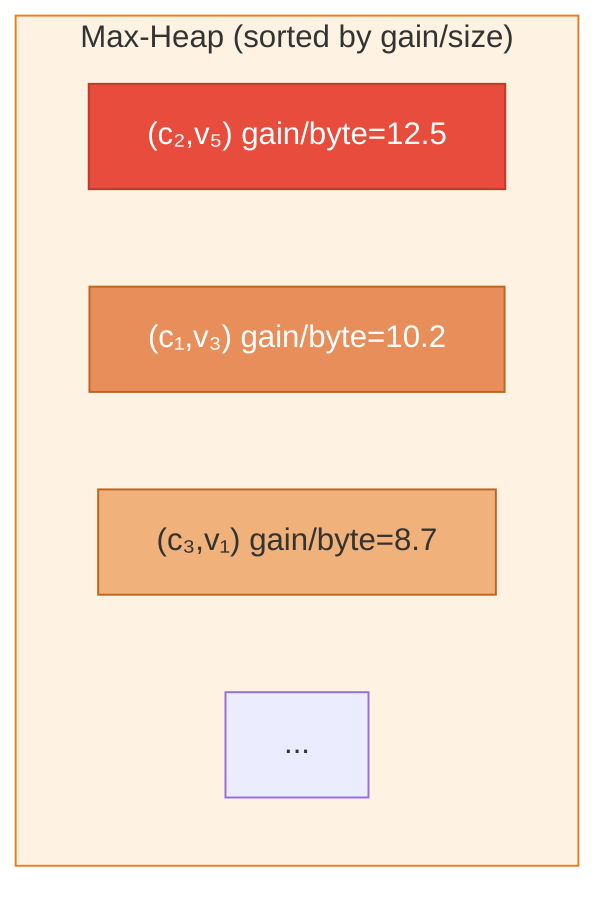
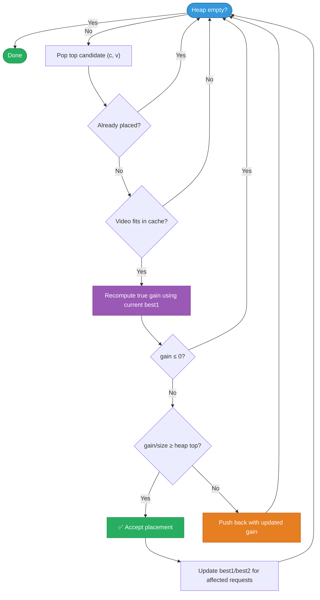

# GreedyCELFSolver

A **naive greedy** approach recomputes the marginal gain of *every* (cache, video) pair after each placement  extremely slow.

**CELF (Cost-Effective Lazy Forward)** exploits the fact that marginal gains can only **decrease** as we place more videos. So instead of recomputing everything, we only recompute the **top candidate** and check if it's still the best. If yes, accept it; if not, push it back into the heap with its updated gain. This gives the **same result** as naive greedy but **much faster**.

### Step 1: Flatten Model into Primitive Arrays

The object model (`Video`, `Endpoint`, `Cache`, `RequestDescription`) is converted into flat `int[]` arrays for fast indexed access and zero autoboxing overhead.

### Step 2: Compute Initial Gains

For each (cache `c`, video `v`) pair, compute:

```
gain[c][v] = Σ  reqCount[r] × (dcLatency[e] − lat[e][c])
           for all requests r of video v
           where endpoint e is connected to cache c
           and dcLatency[e] > lat[e][c]
```

This is the total latency saved across all requests if we place video `v` on cache `c`, assuming **nothing is cached yet**.

### Step 3: Build Max-Heap

All (cache, video) pairs with positive gain are inserted into a **max-heap** sorted by **gain-per-byte** (`gain / videoSize`). This prioritises small videos with high gains.



### Step 4: CELF Greedy Loop (Core Algorithm)

This is the heart of the solver:




## Complexity

| Aspect | Naive Greedy | CELF |
|--------|-------------|------|
| Per iteration | Recompute **all** (C×V) gains | Recompute **only top** candidate |
| Worst case | O(iterations × C × V × R) | Same (but rarely hit) |
| Typical | — | ~2-5× fewer gain evaluations |
